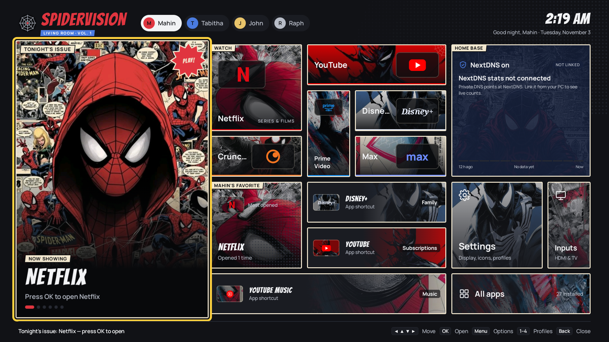
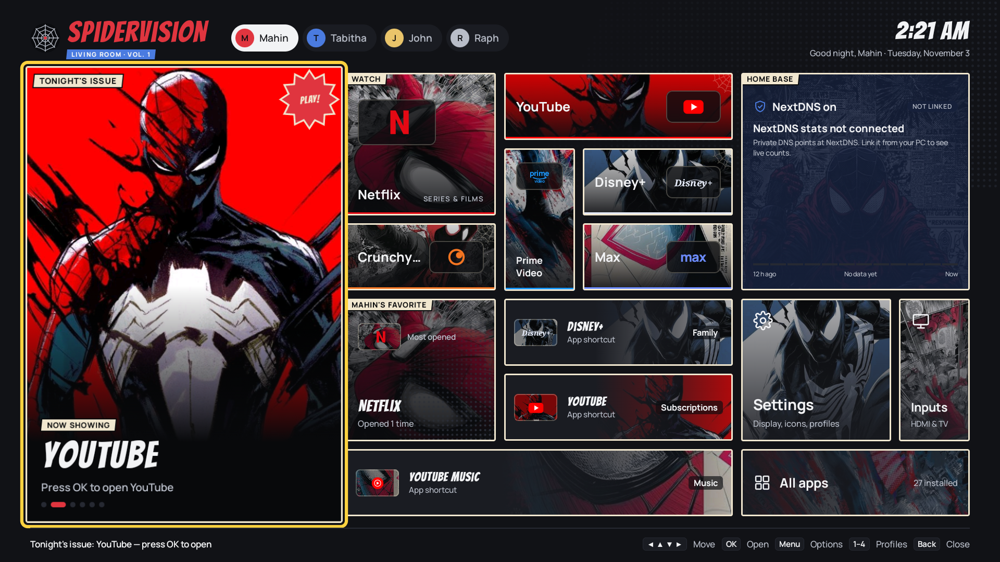
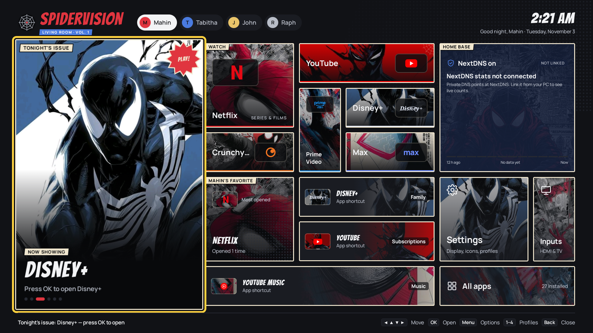
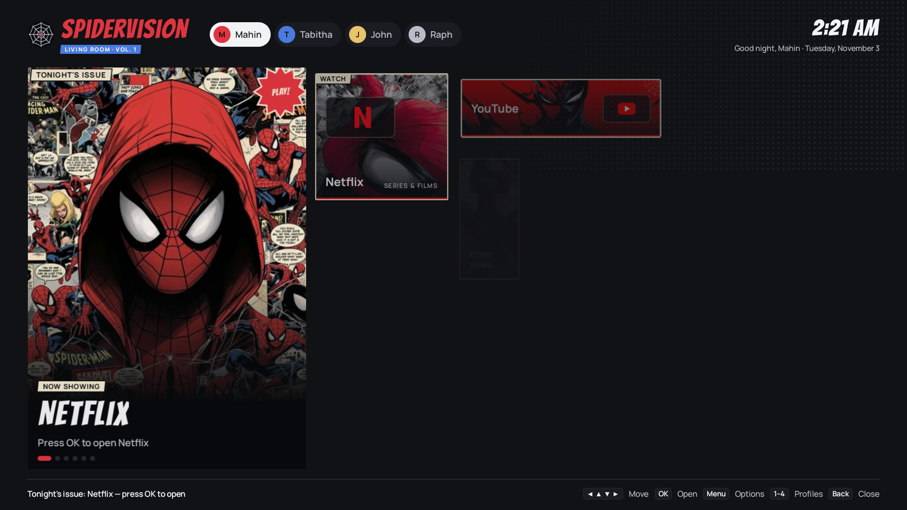
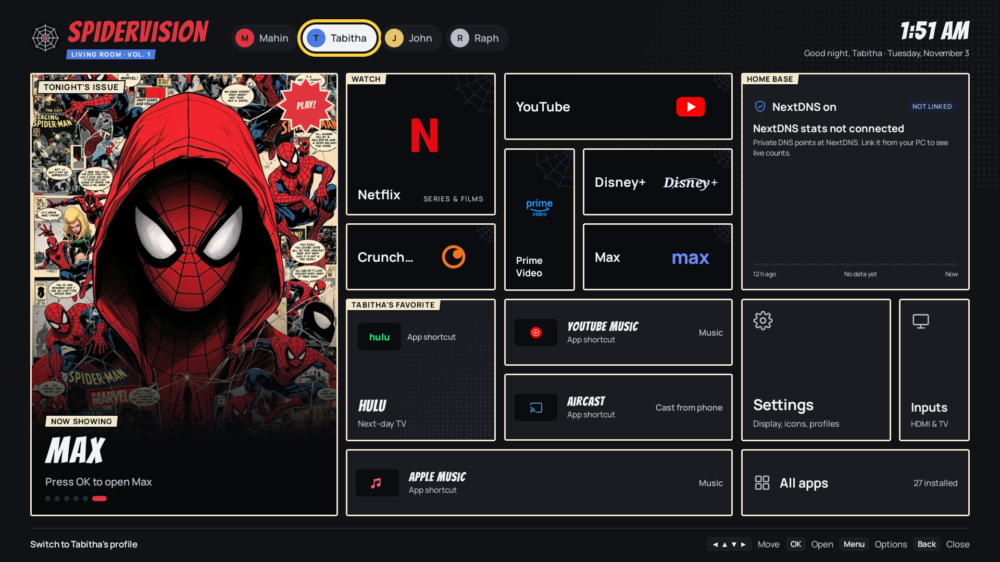
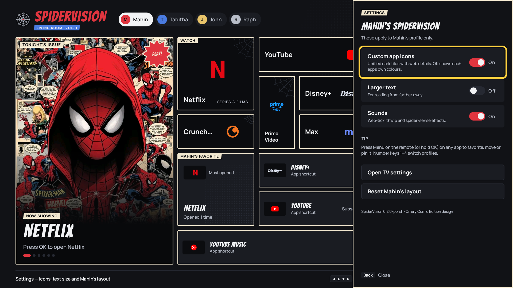
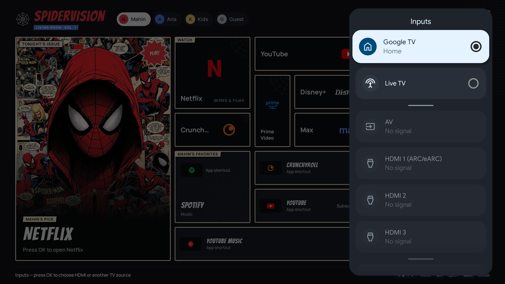

<div align="center">

# 🕸️ SpiderVision

**A comic-book home screen for the living-room TV.**
Native Kotlin + Jetpack Compose · built for one Philips 24NA 4K (Android TV 14) · replaces Google TV home




</div>

---

SpiderVision turns the TV's Home button into a hand-inked comic page: a rotating **Tonight's issue**
cover, art tiles for every streaming app, a per-person favourite that learns from what you open,
and a **Home base** panel for the household's NextDNS. It's driven entirely by the remote, keeps
four separate layouts for the people in the house, and uses about half the memory of the Google TV
launcher it replaces.

## Gallery

<table>
  <tr>
    <td width="50%"><br><sub><b>Tonight's issue</b> rotates Netflix → YouTube → Disney+ → Prime Video → Crunchyroll → Max every 5 s, each with its own poster.</sub></td>
    <td width="50%"><br><sub>Posters crossfade with a comic-panel cut; <b>OK</b> opens whatever is showing.</sub></td>
  </tr>
  <tr>
    <td><br><sub>After the spider-web intro the panels <b>cascade in</b> one after another.</sub></td>
    <td><br><sub><b>Four profiles</b> (Mahin, Tabitha, John, Raph) — remote keys <b>1–4</b> switch, each with its own pins and favourite.</sub></td>
  </tr>
  <tr>
    <td><br><sub><b>Settings</b> slide in from the right: art or original icons, larger text, UI sounds, reset.</sub></td>
    <td><br><sub><b>Inputs</b> opens the TV's own HDMI / Live TV picker.</sub></td>
  </tr>
</table>

## Features

| | |
| --- | --- |
| 🎬 **Tonight's issue** | Big rotating cover with real posters; keeps turning while focused and restarts its timer when you land on it |
| 🖼️ **Art tiles** | Every designed app has its own comic scene, brand plate and colour stripe; 27 installed apps in **All apps** |
| ⭐ **Most-opened favourite** | Each profile's big panel shows the app that person actually opens most |
| 👥 **Household profiles** | Mahin · Tabitha · John · Raph — separate order, pins, cover and settings, saved across reboots |
| 🎮 **Remote-first** | Deterministic D-pad map, **Menu** for app options (favourite, move, pin), number keys for profiles |
| 🛡️ **Home base** | Reads the TV's Private DNS (NextDNS); shows honest *not linked* until a key is delivered over ADB |
| 📺 **Inputs** | HDMI 1–3 and Live TV through the system picker |
| 🕷️ **Spider-web intro** | ~1.6 s live-drawn web, dropping spider and POW logo — once per TV boot, any key skips |
| 🔊 **Thwip sounds** | Original synthesized web-tick, thwip, zip, spider-sense and buzz (37 KB), switchable per profile |
| 🏠 **Real Home app** | Home button opens SpiderVision; Google TV home disabled, with a one-command rollback |

## Performance (measured on the TV, release build)

| | SpiderVision | Google TV home |
| --- | --- | --- |
| Memory (PSS) | **30–36 MB** plain · **~54 MB** with all artwork | 78–107 MB |
| Cold start | **~330 ms** | — |
| Back from Home | **~120 ms** | — |
| D-pad frames | **15 ms** median (was 57 ms before cached panel layers) | — |
| APK | 4.0 MB (R8-minified, 1.7 MB of art) | — |

Details and raw captures: [`docs/PERFORMANCE.md`](docs/PERFORMANCE.md) · [`docs/perf/`](docs/perf/)

## Build, sign, install

Requirements: Android Studio (for its JDK and SDK), `adb` (platform-tools), the TV on Wi-Fi with
network debugging on.

```powershell
# 1. Point Gradle at the SDK once (git-ignored)
"sdk.dir=C:/Users/mahin/AppData/Local/Android/Sdk" | Set-Content local.properties

# 2. Tests + unsigned, minified release
.\gradlew testDebugUnitTest assembleRelease

# 3. Sign with the private release key -> release\SpiderVision-<version>.apk + .sha256
powershell -ExecutionPolicy Bypass -File tools\sign-release.ps1

# 4. Install on the TV as an update (keeps layouts, Home role, NextDNS link)
powershell -ExecutionPolicy Bypass -File tools\install.ps1
```

The release key lives **outside the repo** in `%USERPROFILE%\.spidervision\` — back that folder up;
without it future builds can't update the installed app. A v3 key-rotation lineage lets release
builds install straight over the earlier debug-signed ones.

## Tools

| Script | What it does |
| --- | --- |
| [`tools/sign-release.ps1`](tools/sign-release.ps1) | Signs the release APK with the off-repo key and lineage, writes the SHA-256 |
| [`tools/install.ps1`](tools/install.ps1) | Checks the SHA-256, `adb install -r`, prints version and Home-role holder |
| [`tools/rollback-home.ps1`](tools/rollback-home.ps1) | Gives the Home button back to Google TV and verifies against the backup |
| [`tools/link-nextdns.ps1`](tools/link-nextdns.ps1) | Hidden prompt for a NextDNS API key, delivered straight to the TV's encrypted store |
| [`tools/make_art.ps1`](tools/make_art.ps1) | Crops `art-src/` to the exact tile, panel and poster sizes |
| [`tools/make_sounds.py`](tools/make_sounds.py) | Synthesizes the five UI sounds |
| [`tools/soak.sh`](tools/soak.sh) | Random D-pad soak test with memory and crash sampling |

## Undo everything

```powershell
powershell -ExecutionPolicy Bypass -File tools\rollback-home.ps1                         # Google TV home back
powershell -ExecutionPolicy Bypass -File tools\rollback-home.ps1 -UninstallSpiderVision  # ...and remove SpiderVision
```

Always run the rollback **before** a factory reset or uninstalling SpiderVision. No PC? See
[`docs/ROLLBACK.md`](docs/ROLLBACK.md) for the on-TV steps.

## Under the hood

```text
app/src/main/java/com/spidervision/tv/
├── MainActivity.kt        Home intent, Back handling, intro gate
├── apps/                  leanback discovery, launch, ordering, launch counts
├── network/               Private DNS status, NextDNS client, Keystore vault, ADB-only receiver
├── profiles/              household profiles + DataStore layouts
└── ui/                    board grid, D-pad focus map, panels, sheets, art cache, sounds, intro
```

- **Board:** a 12 × 6 `BoardGrid` on a 960 × 540 dp canvas; D-pad neighbours are computed from the
  cells (`FocusMap`) so every move is predictable.
- **Rendering:** each panel is its own layer with its artwork cached offscreen; focus only redraws
  the rings. Art is decoded as 16-bit off the main thread into an 8 MB LRU.
- **Privacy:** no analytics, no account data in the APK; the NextDNS key is AES-GCM encrypted
  with Android Keystore and only the ADB shell can deliver it.
- **Tests:** 11 JVM unit tests for ordering, focus map and usage ranking.

## Docs

| | |
| --- | --- |
| [Implementation progress](docs/IMPLEMENTATION_PROGRESS.md) | Phase-by-phase log, phases 0–7 |
| [Design fidelity](docs/DESIGN_FIDELITY.md) | Match against the approved Orrery Comic Edition design |
| [Test matrix](docs/TEST_MATRIX.md) | What was verified on the TV and how |
| [Home experiment](docs/HOME_EXPERIMENT.md) | How SpiderVision became the Home app on this firmware |
| [NextDNS](docs/NEXTDNS.md) · [Performance](docs/PERFORMANCE.md) · [Rollback](docs/ROLLBACK.md) | |
| [Changelog](CHANGELOG.md) | Release notes |

Design source: [`references/APPROVED_ORRERY_COMIC_EDITION.png`](references/APPROVED_ORRERY_COMIC_EDITION.png)
and the original MagicPath export in [`references/magicpath-original/`](references/magicpath-original/).

---

<sub>**Private household project.** Spider-Man and related artwork are © Marvel; app names and
logos belong to their owners. Both are used here for one family's TV only — don't publish this
repository, its screenshots or its APKs. Bangers and Manrope fonts under the
[SIL Open Font License](licenses/).</sub>
